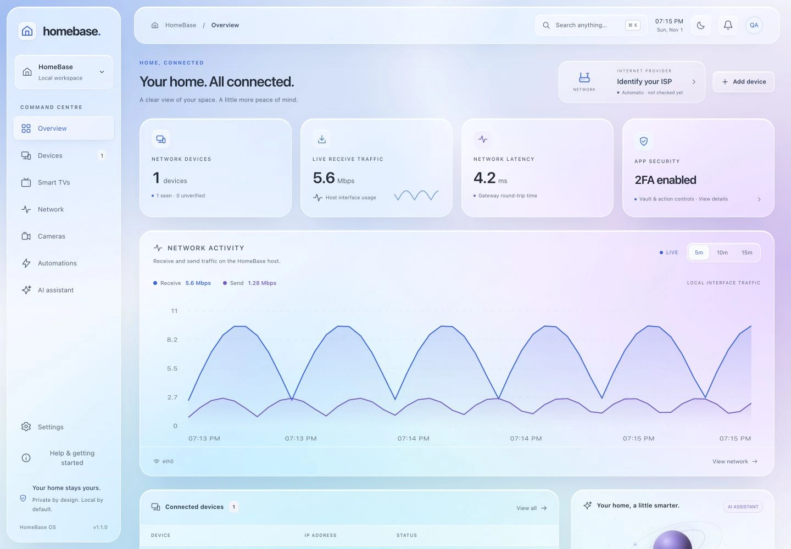
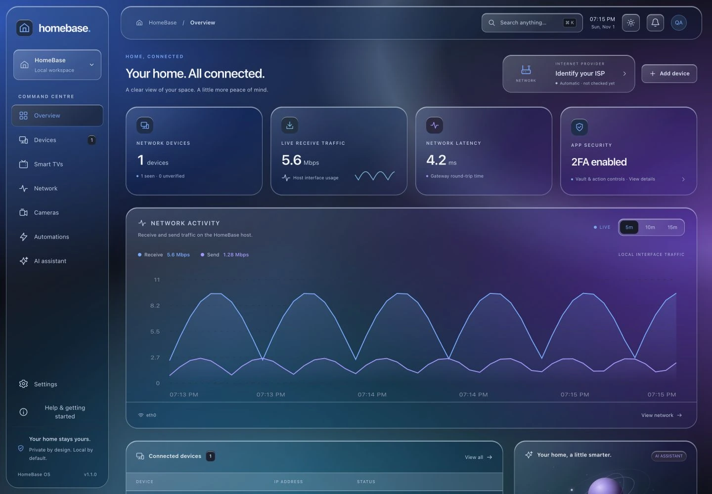

# HomeBase OS v1.1.0 — The Liquid Glass Update

HomeBase gets a complete visual refresh, from first sign-in to the last remote button. Light and dark mode now share a transparent liquid-glass design with soft colour, reflective edges and floating navigation, while the command centre continues to run on your own hardware.

## A new surface for every connection

- **Matching light and dark glass themes.** Clear panes reveal a fixed blue, violet and cyan backdrop. Deep navy surfaces and readable white text give dark mode the same glass treatment without turning it into light mode.
- **Floating navigation.** Rounded sidebar and header surfaces share the new glass borders and depth treatment.
- **One coherent interface.** Sign-in, overview cards, forms, dialogs, settings, device lists, TV remotes and keyboard controls follow the same presentation.
- **Rounded Devices filters.** The filter rail now follows its buttons' rounded shape, including narrow phone layouts.
- **Built for different viewing needs.** Reduced-transparency and high-contrast preferences restore opaque surfaces; reduced-motion handling remains. Browsers without backdrop filters retain solid fallbacks. Phone layouts use a lighter blur, and individual keyboard keys do not create their own filtered layers.

These are presentation changes. Existing accounts, saved integrations, device pairing and action-approval settings keep their behavior. There is no data migration or new cloud service.

## Included since earlier source previews

This release also brings together the work already available on `main` after the earlier v1.0.0 release bundles:

- A full-screen local sign-in page and first-account guidance.
- An optional **Disable 2FA** flow that verifies the current password and a fresh unused authenticator code, then revokes all sessions.
- A dedicated **Smart TVs** area, expanded capability-aware remotes and a digital keyboard. Immediate manual TV commands remain a per-device opt-in; assistant proposals still require approval.
- Modern LG webOS secure-port pairing with explicit certificate enrollment and a saved SHA-256 identity pin.
- Updated local ISP/provider artwork and setup documentation.

Samsung pairing can still fail to display an approval prompt on some models; this appearance release does not address that issue. TV support remains dependent on model, protocol, device permissions and successful authorized pairing.

## Preview





The images show the actual interface with sample telemetry; no device inventory or account credentials are bundled.

## Install

Use **Raspberry Pi OS Lite (64-bit)** with Docker Engine and Compose v2 installed. Start with the [complete installation tutorial](https://grillmaster353.github.io/homebase-os/setup.html), from preparing an OS image through HTTPS trust and first sign-in.

Download `homebase-os-v1.1.0-source.zip` and `homebase-os-v1.1.0-source.zip.sha256` from this release. Verify the archive before extracting:

```sh
# macOS
shasum -a 256 -c homebase-os-v1.1.0-source.zip.sha256

# Linux
sha256sum -c homebase-os-v1.1.0-source.zip.sha256
```

From the extracted source folder on your Pi:

```sh
sudo bash scripts/setup-pi.sh
```

The wizard asks you to choose your own administrator username and password. No default account, runtime vault, private certificate or AI model is included.

## Upgrade without losing your setup

1. Make a private backup of the existing Docker data/workspace volumes, `certs/` and `.setup-ca/`.
2. Keep the same source directory, Compose project and persistent volumes. Review local source edits first.
3. For a clean Git checkout, select the release and rebuild:

```sh
git status --short
git fetch origin tag v1.1.0
git checkout v1.1.0
sudo docker compose -f compose.yaml -f compose.lan.yaml up -d --build
```

Do **not** use `down -v` for an update. It removes saved account/vault/workspace data. The existing local administrator and saved settings are retained. Refresh the browser after rebuilding and sign in again if the service restart expires your session.

## Validation and boundaries

The design was reviewed in desktop and phone-sized browser layouts, including a 390 px viewport without horizontal overflow. The 58 offline UI/theme contracts passed for the redesign. GitHub CI verifies the Python fixtures, UI contracts, public export and ARM64/AMD64 image builds for the release source; check the linked run before treating a downloaded tag as verified.

No physical Raspberry Pi performance, universal TV compatibility or new thermal results are claimed. Cameras still use supported authenticated JPEG snapshots; no RTSP recording/transcoding service is included. Home Assistant and AI providers remain separately configured integrations. The project has not undergone an independent security audit.

GitHub Pages hosts the documentation, not your dashboard. Your authenticated HomeBase installation remains on your hardware and trusted home network.
